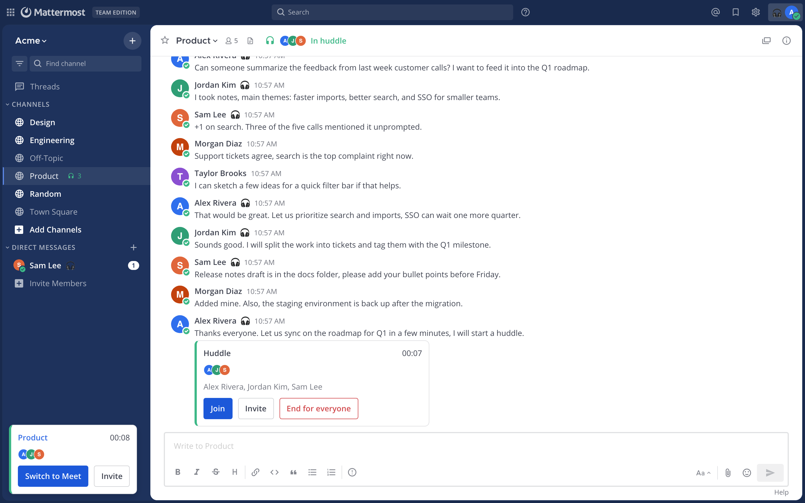
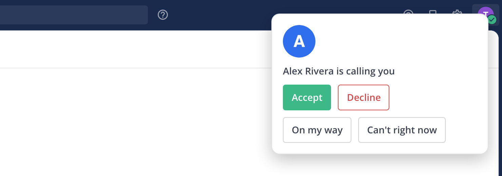
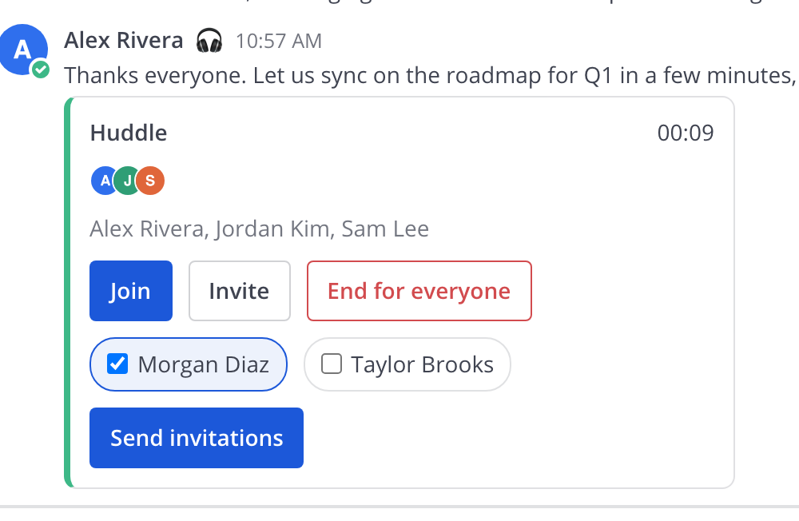
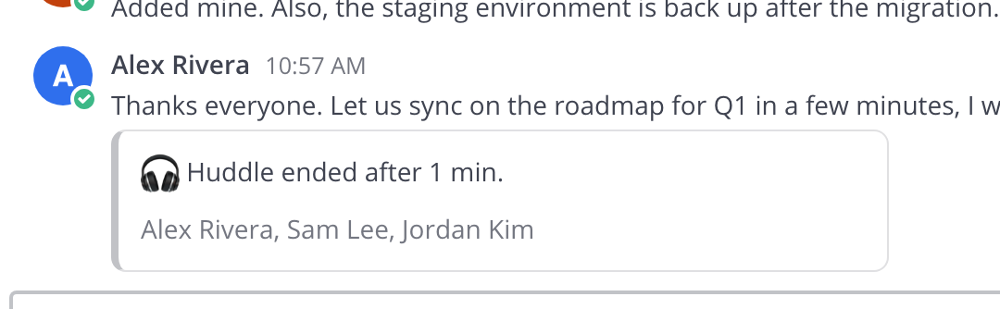
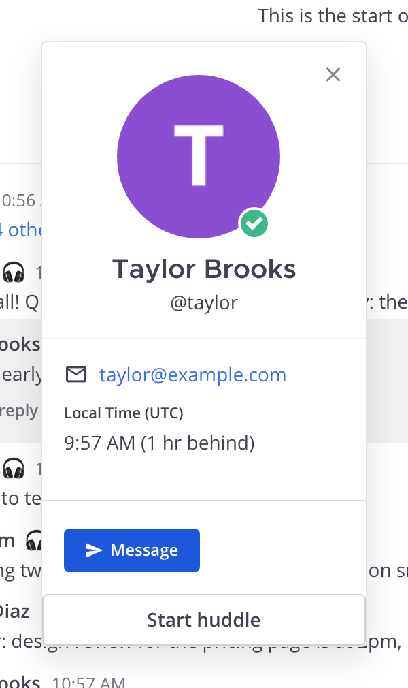
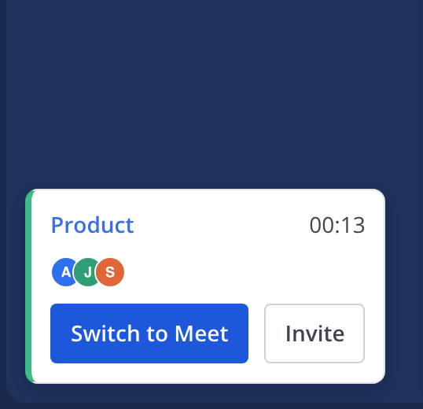

# Meet Huddles for Mattermost

Slack-style huddles for Mattermost, backed by Google Meet. Start a huddle with one click, ring people, see
who is in it, and get the recording links afterwards.

[](https://github.com/schnaq/mattermost-plugin-meet/actions/workflows/ci.yml)
[](LICENSE)




## Features

- **One-click huddles** from the channel header, in channels, DMs and group DMs, from a user's profile popover, or with `/meet`.
- **Ringing:** incoming call dialog with ringtone, Accept, Decline and quick replies. Answering on one device stops the ring everywhere. Unanswered calls become a "missed huddle call". Do Not Disturb is respected.
- **Live presence:** participant avatars on the huddle card, an "in a huddle" custom status (your previous status is restored afterwards), a headphones marker with participant count in the sidebar, and a channel banner.
- **Floating widget** while you are in a huddle: timer, avatars, switch to Meet, invite, jump to the channel.
- **Invite people** to a running huddle; the person who started it can end it for everyone.
- **Summary card** after the end with duration and participants, plus links to recordings, transcripts and notes once Google makes them available.
- **Housekeeping:** huddles nobody joined or that run unattended end automatically, and the Meet space is locked afterwards so an old link cannot start a ghost call.
- **Per-user settings** for ring sound and ring dialog; English and German.

| | |
| --- | --- |
|  |  |
| Incoming call with Accept, Decline and quick replies | Invite channel members |
|  |  |
| Summary with duration, participants and artifacts | Join or start a huddle from a profile |
|  | |
| Floating widget while you are in a huddle | |

## How it works

For every huddle the plugin creates a new, open Google Meet space through the
[Meet REST API v2](https://developers.google.com/workspace/meet/api/guides/overview). It authenticates as a
Google service account with domain-wide delegation and acts as the Google user that hosts the huddle.
While a huddle is active, the plugin polls Meet for the current participants (every 15 seconds, faster right
after a start, join or invite) and maps the Google users back to Mattermost users using the
`GoogleAccounts` setting. Google Meet cannot be embedded in Mattermost, so the video call opens in a browser
tab; everything around it (start, ring, presence, invite, end, follow-up) happens in Mattermost.

The raw Meet link is never posted to the channel. It is handed only to channel members who click Join.

## Requirements

- Mattermost server 12.1 or newer.
- A Google Workspace domain whose users can use Google Meet, and admin access to create a service account and to set up domain-wide delegation.
- The Google Meet REST API and the Admin SDK API enabled in a Google Cloud project.

## Installation

1. Set up Google first: [docs/google-setup.md](docs/google-setup.md).
2. Download `com.schnaq.meet-<version>.tar.gz` from the [latest release](https://github.com/schnaq/mattermost-plugin-meet/releases/latest).
3. Upload it in **System Console > Plugins > Plugin Management**, or with mmctl:

   ```sh
   mmctl plugin add com.schnaq.meet-<version>.tar.gz
   mmctl plugin enable com.schnaq.meet
   ```

   Uploading plugins must be enabled on your server.
4. Configure the plugin (below) and enable it.

## Configuration

**System Console > Plugins > Meet Huddles**

| Setting | Description |
| --- | --- |
| Service account JSON key (`ServiceAccountJSON`) | The JSON key of the Google service account. Stored in the Mattermost configuration, so treat it as a secret. |
| Google accounts (`GoogleAccounts`) | One line per user: `mattermost-username=google-email`, for example `alice=alice@example.com`. These users host their huddles as that Google account. Lines starting with `#` are ignored. |
| Fallback owner email (`FallbackOwnerEmail`) | Google account that hosts huddles of everyone who is not listed in `GoogleAccounts`. If empty, those users can join huddles but not start them. |
| Status text (`StatusText`) | Custom status text while in a huddle. Default: `In a huddle`. |
| Status emoji (`StatusEmoji`) | Custom status emoji name. Default: `headphones`. |

The plugin never uses a user's Mattermost email address to pick a Google account, because Mattermost emails
are often not verified. The mapping in `GoogleAccounts` is the only source of truth.

Users can turn the ring sound and the ring dialog on or off under **Settings > Huddles**.

## Usage

| Command | Effect |
| --- | --- |
| `/meet` | Start a huddle in the current channel, or join the running one. |
| `/meet @alice @bob` | Start or join a huddle and ring the mentioned channel members. |
| `/meet end` | End the running huddle for everyone (only the person who started it). |

Or click the headphones icon in the channel header.

## Limitations and FAQ

- **Participants are polled, not pushed.** Joins and leaves show up within a few seconds after a join through the plugin and within about 15 seconds otherwise.
- **Guests:** huddle spaces are open, so signed-in Google users with the link join without knocking. Anonymous guests (no Google account) have to knock; that is Google's policy.
- **Mobile apps:** the plugin UI does not run there. The huddle card falls back to a post with a Join button and rings arrive as normal push notifications.
- **Desktop app:** Meet opens in your system browser.
- **Recordings, transcripts and notes** follow your Workspace defaults. The plugin does not turn them on; if someone enables them in Meet, the links are posted in the huddle thread after the call.
- **No remote control:** Meet cannot be controlled from outside, so there is no leave, mute or camera button in Mattermost.
- **Single instance:** the plugin has not been designed for Mattermost high-availability clusters.
- **Do Not Disturb / Out of Office** users are not rung; they see the missed call afterwards.

## Development

See [CONTRIBUTING.md](CONTRIBUTING.md). Manual test checklist: [docs/manual-testing.md](docs/manual-testing.md).

## License

[Apache-2.0](LICENSE)
